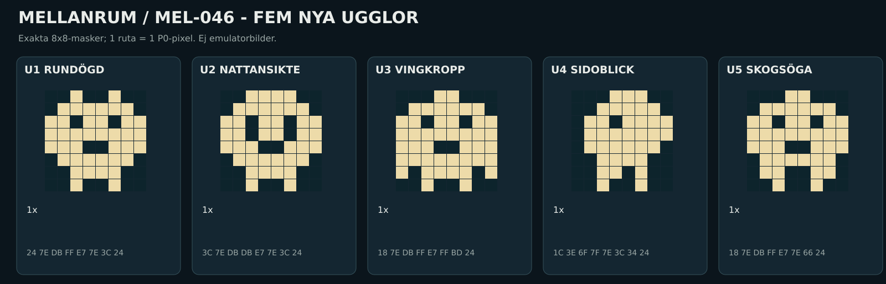
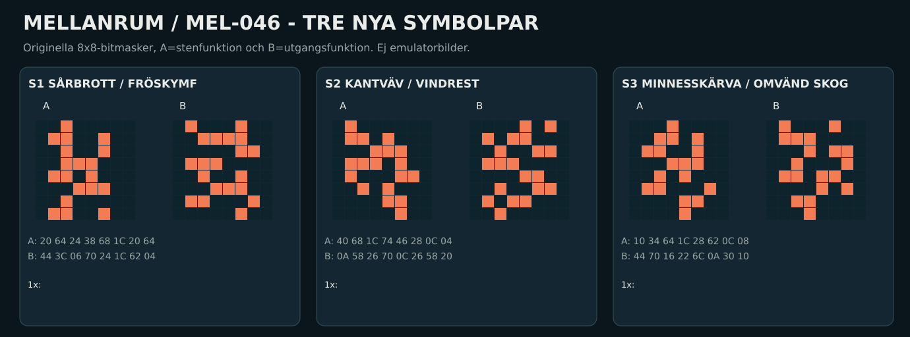

# MELLANRUM – GRAPHICS MEL-046: owl and mysterious glyph redesign

**STATUS:** GRAPHICS_DESIGN_PROPOSED; art-only on a separate branch. **No gameplay/product ROM files changed.** Graphics work to [Issue #13](https://github.com/Odourman/mellanrum/issues/13). The user's specific criticism is [comment 7087781421](https://github.com/Odourman/mellanrum/issues/13#issuecomment-7087781421).

## Authority

MEL-046 (main `docs/DECISIONS.md`) supersedes previous color/camouflage assumptions: glyphs must differ, owl must look like an owl, trees should be green; all other colors are optional. No ROM implementation approved. Design images below are offline 8×8 mask renderings, **NOT Stella/Gopher screenshots**.

## Five new owl candidates (8 rows, top-to-bottom, MSB left)

| ID | VISUAL DESIGN | HEX 8 BYTES (TOP-DOWN) |
|---|---|---|
| U1 RUNDÖGD | `24 7E DB FF E7 7E 3C 24` |
| U2 NATTANSIKTE | `3C 7E DB DB E7 7E 3C 24` |
| U3 VINGKROPP | `18 7E DB FF E7 FF BD 24` |
| U4 SIDOBLICK | `1C 3E 6F 7F 7E 3C 34 24` |
| U5 SKOGSÖGA | `18 7E DB FF E7 7E 66 24` |

**GRAPHICS choice:** U2 NATTANSIKTE, U3 VINGKROPP as fallback. U2 has no projecting antler-like ear tufts, paired dark eye holes and round head.

## Three improved mysterious sigil pairs

| ID | PAIR | A: STONE | B: EXIT |
|---|---|---|---|
| S1 SÅRBROTT / FRÖSKYMF | `20 64 24 38 68 1C 20 64` | `44 3C 06 70 24 1C 62 04` |
| S2 KANTVÄV / VINDREST | `40 68 1C 74 46 28 0C 04` | `0A 58 26 70 0C 26 58 20` |
| S3 MINNESSKÄRVA / OMVÄND SKOG | `10 34 64 1C 28 62 0C 08` | `44 70 16 22 6C 0A 30 10` |

**GRAPHICS choice:** S1 SÅRBROTT / FRÖSKYMF, S2 KANTVÄV / VINDREST as fallback. All invented as original bitmap art. No H-ring/helipad, alphabetic sign or real-world ritual glyph intentionally reproduced. Their semantics remain unlabelled in-game.

## ROMDEV evidence boundary

The diagnostic-only [Issue #14 result](https://github.com/Odourman/mellanrum/issues/14#issuecomment-7087999153) reports native Gopher and Stella P0 full original owl + `NUSIZ1=$04` P1 two different **synthetic** 9-byte probe shapes using time-separated `GRP1` writes, all original room geometries, and M0 cursor. This does **NOT** verify any new 8×8 U/S artwork. A future separate ROMDEV test must use exact proposed bytes after MAIN/user visual selection. Green PF + P0 owl + two P1 symbols + M0 cursor is recommended architecture for study, not an implementation authorization.

**Original product unchanged:** PR #4 at `49eb168b17d0254d06cf50d87c60e8fb6016db6e`, ROM SHA256 `e9ea87d381bcf8da39ec055d7d6951ceff97b21d3a798addd10fbbe540c5e974`. Product's separate Gopher 261 vs 262 raster issue remains unresolved.

## Machine-readable source

See [masks.json](./masks.json). Every `owl` and `pair` entry is exactly 8 rows × 8 bits, MSB = left. For a candidate sprite table, reverse visual rows and append a blank ninth byte, matching the old game's indexed orientation only after ROMDEV source review. The pure SVG files share the same arrays.

**No room coordinate, rules, Presence, Pachinko or Verification changes.**
