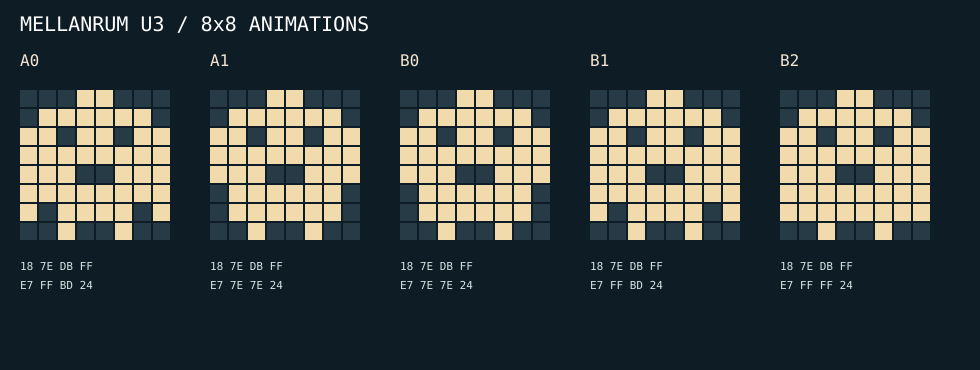
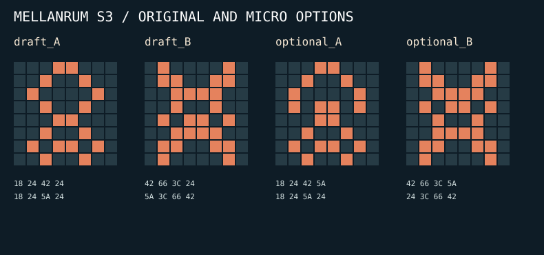

# MELLANRUM - U3 Vingkropp, S3 och Närvaron (GRAPHICS 2026-11-23)
**SOURCE-ONLY ART / GRAPHICS_DESIGN_PROPOSED / NO ROM CHANGES / NEW EMULATOR NOT_RUN**.

## Grafik och exakta sprites

**U3-A, 2 frames:** original `18 7E DB FF E7 FF BD 24`; indragna vingar `18 7E DB FF E7 7E 7E 24`. Unique 9-byte tables 18 bytes.
**U3-B, 3 frames (GRAPHICS recommended):** hvilande `18 7E DB FF E7 7E 7E 24`; mellan `18 7E DB FF E7 FF BD 24`; utbredda `18 7E DB FF E7 FF FF 24`. Unique 9-byte tables 27 bytes. EYES NEVER BLINK: 3rd row DB, 5th row E7 every frame.
Suggested actual gameplay visual timing tied to existing 72-video-frame owl step: B1 6f, B2 6f, B1 6f, B0 54f. This is rendering-only, not a new gameplay beat.

**S3 (retain user's draft):** A `18 24 42 24 18 24 5A 24` and B `42 66 3C 24 5A 3C 66 42`. These are distinct, symmetric zigzag signs. Alternative center micro-edits stored in JSON, but GRAPHICS favors original draft. No symbol animation.

## Närvaron
The frozen PR#4 source uses a crown-only warning and crown+stem active mask on PF2: (PF2 | OR[row]) & AND[row], with a 24-on/40-off video visibility window.
**Presence A:** 2 nearly invisible states, 64 bytes gross (32 bytes extra vs original 32); **Presence B:** 3 distorted negative-space states (GRAPHICS recommended), 96 bytes gross (64 extra). Every exact OR/AND byte table and art-only 64-video-frame preview schedule is in [data](./ANIMATIONS_DATA.json). These are not a new monster sprite.
Preserve original V5.1 actual Presence timing and intervention rules, warning vs active, 15 room coordinates and cursor feedback. Intentional uneven visual substate changes are design proposals not proven code.

## Feasibility boundary
ROMDEV [Issue #14 diagnostic](https://github.com/Odourman/mellanrum/issues/14#issuecomment-7087999153) proved original P0 owl + two separate **synthetic** P1 test glyphs (NUSIZ1=$04), M0 and green PF in a separate native DASM/Gopher/Stella experiment. It did NOT verify the new U3, S3 or Presence frames. Original production ROM is still SHA `e9ea87d381bcf8da39ec055d7d6951ceff97b21d3a798addd10fbbe540c5e974`, PR#4 draft, unchanged. Its Gopher 261-vs-262 frame issue remains open.

**PNG and actual GIF previews, original source-derived forest PF context, technical MD/PDF report, DASM art-only include and ZIP are provided in the user-facing ChatGPT delivery.** This GitHub branch contains portable exact mask data and visual SVG contact sheets, not product code.

## Authority
- [GitHub Issue #13](https://github.com/Odourman/mellanrum/issues/13)
- [latest U3/S3 user context summarized in comment](https://github.com/Odourman/mellanrum/issues/13#issuecomment-7088209327)
- [MEL-046 decisions](https://github.com/Odourman/mellanrum/blob/main/docs/DECISIONS.md)
- Frozen source: `rom/src/main.asm` + `rom/src/data.inc` at PR#4 HEAD `49eb168b17d0254d06cf50d87c60e8fb6016db6e`.

MAIN/user select visual art before any separate ROMDEV test authorization. No merge/release.