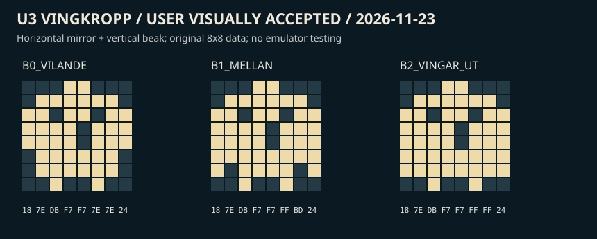

# MELLANRUM – U3 visual acceptance handoff (GRAPHICS)
**Date:** 2026-11-23. **Authority:** user's latest "Nu är det bra" after reviewing U3 horizontally mirrored image/GIF. This is **only visual U3 acceptance**, not permission to implement or merge.

## What is selected

- U3 Vingkropp with a 1×2 negative-space vertical beak; horizontally mirrored, eyes always visible, three exact 8×8 wing frames
- B0 `18 7E DB F7 F7 7E 7E 24`
- B1 `18 7E DB F7 F7 FF BD 24`
- B2 `18 7E DB F7 F7 FF FF 24`
- Three-frame wing sequence selected in prior preview; exact gameplay rhythm B1×6, B2×6, B1×6, B0×54 video frames remains **GRAPHICS PROPOSAL**, not approved timing
- Nine-byte bottom-up indexed tables at [ART_ONLY.inc](./ART_ONLY.inc), 27 raw graphic bytes for three unique masks; +18 bytes against one old 9-byte original owl frame

## What is still open

- S3 (Minnesskärva / Omvänd skog): user prefers the symmetric zigzag direction; latest two literal 8-byte masks `18 24 42 24 18 24 5A 24` and `42 66 3C 24 5A 3C 66 42` remain graphics proposals, not explicitly signed off by user
- Presence B: three PF2 negative-space variants. Recommended, not accepted. Preserve V5.1 24-on/40-off video gate and existing game-state rules
- Colors beyond green trees and exact animation frequency remain artistic/technical review topics

## Engineering boundaries

Issue [#14](https://github.com/Odourman/mellanrum/issues/14#issuecomment-7087999153) demonstrated full original P0 owl, 2 DIFFERENT P1 *diagnostic* glyphs on NUSIZ1=$04, green PF and M0 marker in a **separate diagnostic ROM**; no current art is emulator-verified. Do not double-mirror pre-flipped U3 via REFP0 unless user authorizes reversal. No production source changes, no ROM binary, no game-rule/room edits.

**Frozen PR #4:** `49eb168b17d0254d06cf50d87c60e8fb6016db6e`. Native product SHA-256 `e9ea87d381bcf8da39ec055d7d6951ceff97b21d3a798addd10fbbe540c5e974`, open Draft, not released. Gopher 261-vs-262 issue not resolved. Independent Verification and Pachinko evidence must remain tied to frozen SHA.

## MAIN next step

Register the explicit user choice as a *visual asset decision* in the authoritative decisions register, and request separate approval for S3 and Presence artwork, timing, palette. After that, provide ROM DEVELOPMENT a separate narrow technical test authorization using the exact chosen masks, not old temporary probe patterns. Proof needs full 15 room/same-Y/overlap, 76-cycle, 4KiB/RIOT and actual Stella/Gopher output. No new production implementation/release is authorized by this file.

**Status:** `U3_VISUAL_ACCEPTED`; all other graphics `PROPOSED`; ROM `NOT_RUN`.
